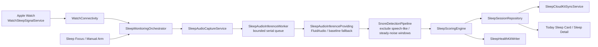
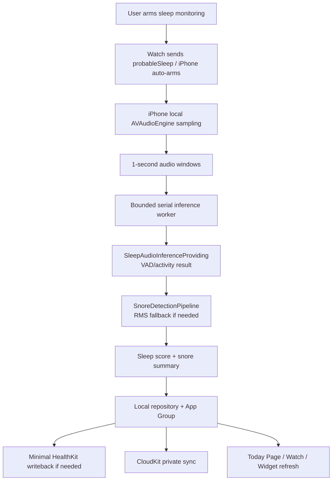
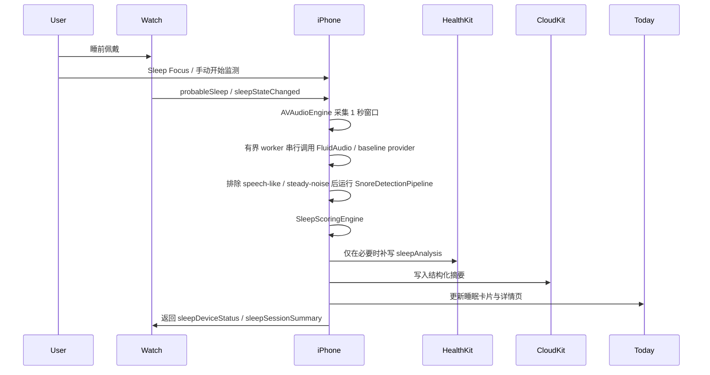

# Mianyu Sleep Monitoring Architecture

## Module Diagram



## Data Flow



## Sequence



## ASCII

```text
+-------------------+        +---------------------------+
| Apple Watch       |        | iPhone                    |
| - sleep signals   |------->| SleepMonitoringOrchestrator|
| - heart/activity  |  WC    | - audio capture           |
+-------------------+        | - snore detection         |
                             | - scoring / insights      |
                             +-------------+-------------+
                                           |
                    +----------------------+----------------------+
                    |                                             |
             +------+-------+                             +-------+------+
             | HealthKit    |                             | CloudKit      |
             | minimal save |                             | private sync  |
             +------+-------+                             +-------+------+
                    |                                             |
                    +----------------------+----------------------+
                                           |
                                   +-------+-------+
                                   | Today / Sleep |
                                   | Watch / Widget|
                                   +---------------+
```
