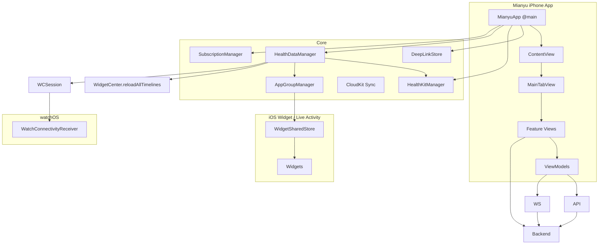

# Mianyu iOS Code Wiki
本 Wiki 面向代码阅读与二次开发，聚焦于 `bio-balance-iOS` 下的 iOS 工程（Xcode multi-target）。内容覆盖整体架构、模块职责、关键类/函数、依赖关系、运行方式与常用配置键。

> **路径约定**：本文档及子文档中的相对路径均以仓库根 `bio-balance-iOS/` 为基准。已对照仓库实际结构核对，关键目录如下：
> - iPhone App 源码：`BioBalance/BioBalance/`
> - iOS Widget 扩展：`BioBalance/BioBalanceWidgetExtension/`
> - watchOS App（当前主用）：`BioBalance/BioBalanceWatch Watch App/`
> - watchOS Complication：`BioBalance/BioBalanceComplications/`
> - 跨 target 共享契约：`BioBalance/Shared/`
> - Xcode 工程：`BioBalance/BioBalance.xcodeproj`

## 目录
- [1. 项目概览](#1-项目概览)
- [2. 构建与依赖](#2-构建与依赖)
- [3. 仓库结构](#3-仓库结构)
- [4. 整体架构](#4-整体架构)
- [5. 启动链路与路由](#5-启动链路与路由)
- [6. 数据流与同步链路](#6-数据流与同步链路)
- [7. 主要模块职责](#7-主要模块职责)
- [8. 关键类与函数索引](#8-关键类与函数索引)
- [9. 配置键与共享存储](#9-配置键与共享存储)
- [10. 运行与开发](#10-运行与开发)
- [11. 测试](#11-测试)
- [12. iCloud / CloudKit 数据架构](#12-icloud--cloudkit-数据架构)
- [13. 相关文档](#13-相关文档)

---

## 1. 项目概览
Mianyu 是一套 SwiftUI iOS 应用，同时包含 Watch App、Widget 扩展与表盘 Complication（WidgetKit）。

**Xcode 工程**
- 工程入口：[BioBalance.xcodeproj](BioBalance/BioBalance.xcodeproj)
- 主要业务代码目录（iPhone App）：[BioBalance](BioBalance/BioBalance)（`BioBalance/BioBalance/` 下的 Swift 文件即 iPhone 主 Target 源码）

**Targets（按目录推断）**
- iPhone App：`BioBalance`（SwiftUI 主 App，源码位于 `BioBalance/BioBalance/`）
- iOS Widget 扩展：`BioBalanceWidgetExtension`（WidgetKit + iOS 18 Control + Live Activity）
- watchOS App：`BioBalanceWatch Watch App`（当前主用，含 `WatchConnectivityReceiver`）；另有较早的平行 target `BioBalanceWatch`
- watchOS Complication 扩展：`BioBalanceComplications`
- Unit Tests：`BioBalanceTests`（scheme 存在，源码已提交，详见第 11 节）

**架构约束文档**
- 分层与目录目标的权威说明见本文第 3 节。本仓库快照未包含独立的 `ARCHITECTURE.md` 文件，如后续补充请在此处链接。

---

## 2. 构建与依赖
**依赖管理**
- CocoaPods：未使用（仓库未发现 `Podfile`）
- Swift Package Manager：未以 `Package.swift` 形式维护；当前工程主要依赖系统框架

**关键系统框架（代码层面可见）**
- SwiftUI（主 UI 框架）
- HealthKit（健康数据读取/写入与后台监听）
- WatchConnectivity（iPhone ↔ Watch 数据同步）
- WidgetKit（iOS Widget、watch complication）
- StoreKit / StoreKit2（订阅/内购）
- ActivityKit（Live Activity 示例）
- UserNotifications（通知权限与本地通知相关）

---

## 3. 仓库结构
本仓库根目录包含多个项目；iOS 工程位于：
- `bio-balance-iOS/BioBalance`

### 3.1 目录树（核心）
```
bio-balance-iOS/
  BioBalance/
    BioBalance.xcodeproj/                 # Xcode 工程（含 BioBalance / BioBalanceWidgetExtension / BioBalanceWatch Watch App / BioBalanceComplications / BioBalanceTests 等 target）
    BioBalance/                           # iPhone App 主 Target 源码
      BioBalanceApp.swift                 # @main 入口
      ContentView.swift                   # 根路由（Onboarding/Login/MainTab）
      Components/                         # UI 组件 + Theme + DesignSystem
      Core/                               # 跨模块系统能力/全局状态
        AI/  Algorithms/  Care/  CloudKit/  Habits/  Health/  HealthProfile/  Notifications/
        Period/  Persistence/  Pregnancy/  Recognition/  Reports/  SocialSharing/  Sync/  VO2Max/
        Watch/  Widget/  Xiaomi/
        AppleSignInManager.swift  DeepLinkStore.swift  SubscriptionManager.swift  UserInfoStore.swift
      Models/                             # 数据结构（DTO/Model）
      ViewModels/                         # MVVM 的 ObservableObject
      Views/                              # SwiftUI 页面（按功能域分包）
    BioBalanceWidgetExtension/            # iOS Widget 扩展
    BioBalanceWatch Watch App/            # watchOS App（当前主用）
    BioBalanceComplications/              # watchOS Complication 扩展
    Shared/                               # 四个 target 共用的 App Group 契约、快照和存取实现
    BioBalanceTests/                      # 单元测试 target（scheme 存在，源码已提交，见第 11 节）
```

> 注：iPhone App 源码实际位于 `BioBalance/BioBalance/`（仓库根 `BioBalance/` 内的同名子目录），并非 `Apps/iOS/BioBalance/`。早期文档中出现的 `Apps/...` 路径均为过时写法，以本 Wiki 为准。

### 3.2 Views 分包约定
见 [Views/README.md](BioBalance/BioBalance/Views/README.md)：
- `Views` 以业务域分包（Activity/Auth/Habits/Health/Reports/Settings/Sleep/Stress/Today/Trends…）
- 跨模块复用视图优先放在 `Shared` 或 `Auxiliary`

---

## 4. 整体架构
整体采用 SwiftUI + MVVM + “少量全局 Store/Manager 单例”的组合：
- **UI 层（Views）**：业务页面与组件，使用 `@StateObject/@ObservedObject/@EnvironmentObject` 绑定状态
- **状态层（ViewModels + Stores）**：典型 `ObservableObject`，承接 API/HealthKit/AppGroup/WatchConnectivity 的数据
- **基础设施层（Core）**
  - HealthKit 读写、后台 observer
  - WatchConnectivity 双向同步
  - App Group 同设备组件共享（iPhone App ↔ Widget、Watch App ↔ Complication）
  - iCloud/CloudKit 跨设备同步（唯一云端链路，不依赖自建 Java 后端）
  - 订阅/内购（StoreKit2 + 模拟购买兜底）

### 4.1 组件/依赖关系（概览）


---

## 5. 启动链路与路由
### 5.1 App 入口与启动任务
入口文件： [MianyuApp](BioBalance/BioBalance/BioBalanceApp.swift#L1-L25)
- `init()`：
  - 注册 HealthKit 后台 observers：`HealthKitManager.shared.registerObserversIfNeeded()`
  - 初始化 `HealthDataManager.shared`（包含 WatchConnectivity 初始化与本地缓存加载）
- `WindowGroup`：
  - 注入 `DeepLinkStore` 为 `environmentObject`
  - `.task`：恢复 Apple 登录态、刷新订阅权益
  - `.onOpenURL`：进入 deeplink 处理

### 5.2 根路由（登录/引导/主页）
见 [ContentView](BioBalance/BioBalance/ContentView.swift#L1-L16)
- `@AppStorage("hasCompletedOnboarding")`
- `@AppStorage("isLoggedIn")` / `@AppStorage("isGuest")`
- 路由选择：
  - 未完成引导：`OnboardingView()`
  - 已登录或访客：`MainTabView()`
  - 否则：`LoginView()`

### 5.3 主 Tab 容器与 Deeplink 路由
主 Tab： [MainTabView](BioBalance/BioBalance/Views/App/Navigation/MainTabView.swift#L31-L232)
- Tabs：今日/健康/目标/我的
- `DeepLinkStore` 监听：
  - `pending` 触发 `handleDeepLink`
  - Widget Deeplink 通过 `.sheet(item:)` 弹出 Stress/Activity/Sleep
- 内购待处理跳转：
  - `@AppStorage("purchase_pending")` + `PurchasePendingRouter.consume(...)` 决定是否自动打开 `PaywallView`

### 5.4 Deeplink 协议
解析器： [DeepLinkStore + MianyuDeepLink](BioBalance/BioBalance/Core/DeepLinkStore.swift#L1-L43)
- scheme：`biobalance://`
- Widget：
  - `biobalance://widget/vitals`
  - `biobalance://widget/stress`
  - `biobalance://widget/activity`
  - `biobalance://widget/sleep`
  - 常量见 [WidgetDeepLink.swift](BioBalance/BioBalanceWidgetExtension/Core/WidgetDeepLink.swift#L1-L8)
- Watch Dashboard：
  - `biobalance://watch/dashboard`
  - 用于 complication `widgetURL(...)`（见 [BioBalanceComplicationWidget.swift](BioBalance/BioBalanceComplications/BioBalanceComplicationWidget.swift#L48-L112)）

---

## 6. 数据流与同步链路
Mianyu 的“数据”主要来源于三条链路：
1) HealthKit（本机健康数据）  
2) iCloud / CloudKit（跨设备同步，唯一云端链路；不依赖自建 Java 后端）  
3) AppGroup（同设备的跨 target 共享快照）

### 6.1 HealthKit → iPhone 内存态 → AppGroup/Widget/Watch
核心协调器： [HealthDataManager](BioBalance/BioBalance/Core/Health/HealthDataManager.swift#L1-L370)
- `syncAllData()`：
  - `HealthKitManager.shared.requestAuthorization()`
  - 并发拉取 steps/energy/exercise/stand/walkingSpeed/audio exposure 等
  - 拉取最新 HR/HRV，并用 Stress 3.1 计算实时压力；无 HRV 设备使用个人心率基线或连续心率趋势（详见 [STRESS_CALCULATION.md](./BioBalance/BioBalance/Core/Algorithms/Stress/Assessment/STRESS_CALCULATION.md)）
  - 将结果写入：
    - 内存 `@Published`（供 UI/VM 绑定）
    - 本地 `UserDefaults.standard`（`saveToLocalStore`）
    - iPhone App Group `AppGroupManager.shared.*`（供 iOS Widget 读取）
  - `WidgetCenter.shared.reloadAllTimelines()` 刷新所有 widget
  - `sendToWatch(...)` 推送到 watch（`updateApplicationContext` + `sendMessage`）
- `pushRealtimeToWatch(...)`：用于将实时健康数据（本机 HealthKit/手动记录）同步到 Watch/Widget

HealthKit 封装： [HealthKitManager](BioBalance/BioBalance/Core/Health/HealthKitManager.swift#L31-L1565)
- `requestAuthorization()`：申请 read/share 权限，覆盖多类数据（心率、HRV、睡眠、步数、经期、冥想等）
- `registerObserversIfNeeded()`：对关键 HKSampleType 注册 `HKObserverQuery` 并开启 background delivery
- 多类 `fetch*` 方法：按 day interval/series 获取统计与样本
- 经期数据写入：`syncCycle`/`syncFlow`（见文件末尾 extension）

### 6.2 iPhone ↔ Watch 数据同步
iPhone 侧： [HealthDataManager](BioBalance/BioBalance/Core/Health/HealthDataManager.swift#L205-L370)
- 作为 `WCSessionDelegate`
- 关键方法：
  - `setupWatchConnectivity()`
  - `sendToWatch(realtime:)`
  - `session(_:didReceiveMessage:)`：接收 Watch 上报（例如 bpm/hrv/stress）并回写到本机 + AppGroup
  - `session(_:didReceiveMessage:replyHandler:)`：响应 `requestSnapshot`，返回当前 payload

Watch 侧（当前主用 `BioBalanceWatch Watch App`）： [WatchConnectivityReceiver](BioBalance/BioBalanceWatch%20Watch%20App/Services/Connectivity/WatchConnectivityReceiver.swift)
- `requestLatestFromiPhone()`：向 iPhone 发 `requestSnapshot` 拉取快照
- `handle(payload:)`：把字典映射为 `WatchRealtimeHealth`，拒绝比当前快照旧的 payload，再写入 Watch 本地 App Group
- 使用 payload 的源时间作为 `lastSyncTime`，避免旧 WCSession 包伪装成刚同步的数据
- fallback：若 payload 缺少指标，Watch 侧用自身 `AppGroupManager.shared.getLatest*` 回退到最近一次同步值

> App Group 不能跨 iPhone 与 Apple Watch 两台设备。iPhone 到 Watch 的数据传输只通过 WCSession；Watch App 再把已接收快照写入 Watch 本地 App Group，供 Complication 读取。

### 6.3 AppGroup → Widget/Complication/Watch 读取
AppGroup 标识：`group.com.biobalance.shared`

四个 target 共用实现：[AppGroupManager.swift](BioBalance/Shared/AppGroupManager.swift)
- 提供 `saveHeartRate/saveHRV/saveStress/saveActivitySummary/saveSleepSummary/saveSedentaryState...`
- 维护较完整的 Key 集合（含目标值、完成率、久坐状态等）
- `AppGroupSnapshotStore` 以 `generatedAt` 拒绝旧快照覆盖新快照
- App Group 只保存组件消费的投影；咖啡因、情绪、打卡、评估、餐饮、经期与同步 Outbox 等 iPhone 结构化业务数据保存在本机 SwiftData 容器
- `LegacyAppGroupDataMigration` 在 App 启动时把旧版本误存于 App Group 的业务 key 迁回本机默认域并删除旧值

Widget 侧读取： [WidgetSharedStore](BioBalance/BioBalanceWidgetExtension/Core/WidgetSharedStore.swift#L1-L64)
- 读取心率/HRV/stress/trend/water/caffeine/lastSyncTime 等快照

watch complication 侧读取： [MianyuComplicationWidget.makeEntry](BioBalance/BioBalanceComplications/BioBalanceComplicationWidget.swift#L13-L46)
- 通过共享的 `AppGroupManager.shared.getLatest*` 读取 Watch App 写入的本地快照

---

## 7. 主要模块职责
### 7.1 按 Target 划分
**iPhone App（BioBalance/BioBalance）**
- `BioBalanceApp.swift`：App 生命周期、全局 store 注入、启动任务
- `ContentView.swift`：根路由（Onboarding/Login/MainTab）
- `Views/`：业务页面（按功能域分包，见 Views/README）
- `ViewModels/`：页面状态与业务逻辑（如 Dashboard/Habit/Sleep/Trends/Subscription…）
- `Core/`：跨模块能力（HealthKit/WatchConnectivity/AppGroup/AppleSignIn/iCloud/CloudKit/本地 store）
- `Components/`：通用 UI 组件与主题（Theme/DesignSystem）

**Widget 扩展（BioBalanceWidgetExtension）**
- [BioBalanceWidgetBundle](BioBalance/BioBalanceWidgetExtension/Widgets/BioBalanceWidgetBundle.swift#L11-L24)：聚合多个 Widget
- Widgets：Vitals/Stress/Activity/Sleep + Configurable Widget + Live Activity + iOS18 Control
- `WidgetSharedStore`：读取 AppGroup 快照
- `WidgetDeepLink`：deeplink 常量

**watchOS（BioBalanceWatch Watch App）**
- `BioBalanceWatchApp.swift`：watch app 入口（位于 `BioBalance/BioBalanceWatch Watch App/App/BioBalanceWatchApp.swift`）
- `WatchConnectivityReceiver`：接收 iPhone 数据、请求快照、写入 AppGroup
- Watch 侧读取统一经由其自身的 `AppGroupManager`，不再依赖独立 `WatchSharedStore` 类型

**Complication（BioBalanceComplications）**
- `MianyuComplicationWidget`：watch 表盘组件（WidgetKit）
- 15 分钟刷新一次 timeline，并设置 `widgetURL(biobalance://watch/dashboard)`

### 7.2 按 iPhone App 目录划分
**Components/**
- `Theme.swift`：全局颜色/字体/布局常量 + `Color(hex:)` 扩展（见 [Theme.swift](BioBalance/BioBalance/Components/Theme.swift#L1-L97)）
- `DesignSystem/`：更具体的 UI 组件封装（BBButtons/BBCard/BBMetricRow/BBStateView…）

**Core/**
- `Health/`
  - `HealthKitManager`：HealthKit 权限、查询、后台监听、经期写入
  - `HealthDataManager`：聚合数据、计算 stress、写 AppGroup、推送 Watch、刷新 Widget
- `Algorithms/`：健康算法（Stress / Sleep / Heart / VO2Max 等，含各算法说明文档）
- `CloudKit/`：CloudKit 增量同步、策略与共享仓储（`CloudKitSupport.swift` / `ICloudSyncCoordinator.swift` 等）
- `Sync/LocalSyncOutbox.swift`：本地待发送队列（revision/租约，SwiftData 持久化）
- `Persistence/`：SwiftData 容器与受控数据迁移
- `Habits/HabitCheckinStore`：每日习惯打卡类型集合持久化
- `Period/PeriodStore`：经期周期与日记本地计算/预测
- `Notifications/`：习惯提醒与本地通知调度（与 Settings 中通知开关联动）。PEN-85 决策：长通知暂不实现——不主动创建 Live Activity（长驻通知，避免提前数小时长驻打扰用户、聚焦核心功能稳定），保留 dynamicIsland/锁屏短形态（MianyuWidgetLiveActivity）与既有活动更新/清理能力
- `SubscriptionManager`：订阅/内购（StoreKit2，见 [SubscriptionManager.swift](BioBalance/BioBalance/Core/SubscriptionManager.swift)）
- `AppleSignInManager`：Apple 登录态持久化、恢复、登出与账号删除（见 [AppleSignInManager.swift](BioBalance/BioBalance/Core/AppleSignInManager.swift#L8-L192)）
- `DeepLinkStore`：deeplink 解析与 pending 分发
- AppGroup 跨 target 共享实现位于 `Shared/AppGroupManager.swift`（不再位于 `Core/AppGroup/`）

**Models/**
- `HealthModels.swift`、`Core/Algorithms/Stress/Assessment/Domain/StressModels.swift`：核心数据结构（API decode / 压力评估领域与 UI 展示用）

---

## 8. 关键类与函数索引
### 8.1 入口与路由
- [MianyuApp](BioBalance/BioBalance/BioBalanceApp.swift#L1-L25)
  - `init()`：HealthKit observer + HealthDataManager 初始化
  - `onOpenURL`：`DeepLinkStore.handle(_:)`
- [ContentView](BioBalance/BioBalance/ContentView.swift#L1-L16)
  - `@AppStorage` 三态路由：onboarding / main / login
- [MainTabView.handleDeepLink](BioBalance/BioBalance/Views/App/Navigation/MainTabView.swift#L205-L223)
  - 将 `MianyuDeepLink` 映射为 tab 切换与 modal route

### 8.2 健康数据与同步
- [HealthKitManager.requestAuthorization](BioBalance/BioBalance/Core/Health/HealthKitManager.swift#L81-L143)
- [HealthKitManager.registerObserversIfNeeded](BioBalance/BioBalance/Core/Health/HealthKitManager.swift#L1446-L1483)
- [HealthDataManager.syncAllData](BioBalance/BioBalance/Core/Health/HealthDataManager.swift#L67-L158)
- [HealthDataManager.pushRealtimeToWatch](BioBalance/BioBalance/Core/Health/HealthDataManager.swift#L24-L32)
- [HealthDataManager.pushSedentaryToWatch](BioBalance/BioBalance/Core/Health/HealthDataManager.swift#L34-L56)

### 8.3 云端同步（iCloud / CloudKit）
- 多设备/云同步统一走 iCloud/CloudKit，不依赖自建 Java 后端（详见 [ICLOUD_DATA_ARCHITECTURE.md](ICLOUD_DATA_ARCHITECTURE.md)）。

### 8.4 登录与账号
- [AppleSignInManager.restorePreviousSignInIfNeeded](BioBalance/BioBalance/Core/AppleSignInManager.swift#L35-L59)
- [AppleSignInManager.signOut/deleteAccount](BioBalance/BioBalance/Core/AppleSignInManager.swift#L66-L92)
- [UserInfoStore](BioBalance/BioBalance/Core/UserInfoStore.swift#L1-L26)

### 8.5 订阅与内购
- [SubscriptionManager](BioBalance/BioBalance/Core/SubscriptionManager.swift#L8-L490)
  - `refreshEntitlement()`：刷新权益（真机 StoreKit2 或模拟模式）
  - `purchase(sku:)` / `restorePurchases()`：购买与恢复
  - `loadProducts()`：读取 products，模拟器无法读取时自动降级为模拟购买

### 8.6 AppGroup 与跨端共享
- [AppGroupManager](BioBalance/Shared/AppGroupManager.swift)
  - `saveActivitySummary/saveSleepSummary/saveSedentaryState`：写入跨端快照
  - `get*`：各 target 的统一读取入口
- [AppGroupHealthSnapshot](BioBalance/Shared/AppGroupHealthSnapshot.swift)：统一快照模型
- [AppGroupSnapshotStore](BioBalance/Shared/AppGroupSnapshotStore.swift)：统一快照持久化和时间戳防回退
- [WidgetSharedStore.loadSnapshot](BioBalance/BioBalanceWidgetExtension/Core/WidgetSharedStore.swift#L27-L63)
- Watch App 与 Complication 使用同一份共享实现，不再保留 target 内 App Group 包装类型

---

## 9. 配置键与共享存储
### 9.1 SwiftData（iPhone App 本机结构化数据）
- 统一容器与 schema：`BioBalance/BioBalance/Core/Persistence/BioBalanceModelContainer.swift`
- SwiftData 配置显式使用 `groupContainer: .none` 与 `cloudKitDatabase: .none`；它不是 App Group 或 CloudKit 同步通道
- 每条记录使用 `domain + kind + recordID` 稳定键，并保留 `occurredAt` / `updatedAt` 查询索引与 Codable payload
- 当前覆盖：咖啡因事件、情绪记录、每日行动/打卡、心理评估、饮品/餐食、经期状态、`LocalSyncOutbox`
- 旧 `UserDefaults` payload 以一次性 migration marker 迁移；记录与 marker 同事务保存成功后才删除旧 key

### 9.2 UserDefaults / AppStorage（iPhone App）
路由与登录态（见 [ContentView](BioBalance/BioBalance/ContentView.swift#L3-L16) 与 [AppleSignInManager](BioBalance/BioBalance/Core/AppleSignInManager.swift#L117-L128)）：
- `hasCompletedOnboarding`：是否完成引导
- `isLoggedIn`：登录态
- `isGuest`：访客态

购买流程：
- `purchase_pending`：进入主界面后是否强制打开付费墙（见 [MainTabView.handlePurchasePending](BioBalance/BioBalance/Views/App/Navigation/MainTabView.swift#L225-L232)）
- `purchase_pending_sku`：付费墙默认 SKU（若存在）

订阅权益（见 [SubscriptionManager](BioBalance/BioBalance/Core/SubscriptionManager.swift#L17-L36)）：
- `isPro`
- `pro_is_lifetime`
- `pro_expires_at`
- `debug_force_pro_unlocked`
- `simulated_storekit_*`（模拟购买状态）

### 9.3 AppGroup（group.com.biobalance.shared）
统一标识：`group.com.biobalance.shared`

主 Key 集合见 [AppGroupManager.Keys](BioBalance/Shared/AppGroupManager.swift)，核心包含：
- 实时健康：`latestHeartRate` / `latestHRV` / `latestStress` / `stressTrend` / `lastSyncTime`
- Activity：`steps` / `activeEnergy` / `exerciseMinutes` / `standHours` + goals + completion rates
- Sleep：`sleepDurationMinutes` / `sleepScore` / `sleepGoalMinutes` / `sleepDurationCompletionRate`
- Habits：`waterIntakeMl` / `waterTargetMl` / `waterCompletionRate` / `caffeineRemainedMg`
- 久坐：`sedentaryElapsedMinutes` / `sedentaryIsCounting` / `sedentarySeatedStartAt` / `sedentaryLastActivityAt` / `sedentaryUpdatedAt`

---

## 10. 运行与开发
### 10.1 启动工程
1. 使用 Xcode 打开：
   - `bio-balance-iOS/BioBalance/BioBalance.xcodeproj`
2. 选择 Scheme（按你要跑的 target）：
   - iPhone：`BioBalance`
   - iOS Widgets：`BioBalanceWidgetExtension`
   - watchOS：`BioBalanceWatch Watch App`（当前主用）
   - watch complication：`BioBalanceComplications`
   - Tests：`BioBalanceTests`

### 10.2 签名与能力（必做）
- 配置 Team、Bundle ID、Provisioning
- 启用并配置：
  - HealthKit（真机授权与后台能力）
  - App Groups：`group.com.biobalance.shared`（App/Widget/Watch/Complication 需要一致）
  - In-App Purchase（订阅/内购）
  - Push/Notifications（如涉及提醒）

### 10.3 云端同步（iCloud / CloudKit）
- 多设备/云同步统一走 iCloud/CloudKit，**不依赖自建 Java 后端（bio-balance-backend）**，App 无 8080 端口依赖。
- 云端链路说明、隐私边界与发布验收见 [ICLOUD_DATA_ARCHITECTURE.md](ICLOUD_DATA_ARCHITECTURE.md) 与 `BioBalance/BioBalance/Docs/CloudKitOperationsRunbook.md`。

### 10.4 Widget / Watch 联动验证
- iPhone 侧触发全量同步：`HealthDataManager.shared.syncAllData()`（例如引导页会调用）
- Widget 刷新依赖 `WidgetCenter.shared.reloadAllTimelines()`（已在 HealthDataManager 中触发）
- Watch 若可达会主动 `requestLatestFromiPhone()` 拉取快照（见 [WatchConnectivityReceiver](BioBalance/BioBalanceWatch%20Watch%20App/Services/Connectivity/WatchConnectivityReceiver.swift)）

### 10.5 内购测试（建议）
- `Views/App/Commerce/BalenWatchSubscriptions.storekit`：本地 StoreKit 配置文件（可用于模拟器测试）
- 模拟器读不到商品时会自动降级为“模拟购买模式”，并给出提示（见 [SubscriptionManager.loadProducts](BioBalance/BioBalance/Core/SubscriptionManager.swift#L234-L271)）

---

## 11. 测试
测试 target：
- `BioBalanceTests`（scheme 已存在，位于 `BioBalance/BioBalance.xcodeproj/xcshareddata/xcschemes/BioBalanceTests.xcscheme`）

测试源码已提交，按目录覆盖以下模块（当前约 42 个 `*Tests.swift`）：

- `AI/`：AI 配置、HTTP 客户端、Provider 路由、千问 Provider 与核心契约
- `Application/`：自适应布局上下文
- `Cache/`：AppDataCacheManager、AppGroup 快照同步
- `Charts/`：趋势图分析、行为影响分析、心律关系、心律稳定性
- `CloudKit/`：`CloudKitDataPolicyTests`（隐私白名单策略）、`CKSyncEngineTransportTests`（增量同步传输）
- `Dashboard/`：刷新策略
- `Fitness/`：健身 AI 洞察、心率区间汇总
- `Health/`：授权偏好、健康首页展示、档案缓存、用药处方识别、生殖健康页
- `Navigation/`：DeepLinkStore 深链解析
- `Persistence/`：SwiftData 持久化、受控迁移、Legacy App Group 迁移、餐饮记录兼容
- `Sleep/`：`SleepCloudKitSyncTests`（睡眠云同步）、睡眠评分引擎
- `Social/`：`SocialSharingPermissionTests`（好友共享权限）
- `Stress/`：压力引擎、规则、展示存储、Body Battery、VO2Max、专注容量
- `Watch/`：Watch 快照仲裁、同步 payload 与工厂
- `Widget/`：App Intents 测试框架、Widget 相关性解析

运行方式（模拟器、免签名）：

```sh
xcodebuild test -project BioBalance.xcodeproj -scheme BioBalance \
  -destination 'platform=iOS Simulator,name=iPhone 17 Pro' \
  -only-testing:BioBalanceTests/CloudKitDataPolicyTests
```

Xcode 中也可直接选择 `BioBalanceTests` scheme 执行 Test。

---

## 12. iCloud / CloudKit 数据架构
CloudKit 用于显式好友共享和部分用户私有数据的可选跨设备恢复；它不承担全量健康数据云同步，也不能成为本地记录与计算的运行前提。完整的容器、zone、record、隐私、冲突、删除、账号切换和 Production 部署合同见 [ICLOUD_DATA_ARCHITECTURE.md](./ICLOUD_DATA_ARCHITECTURE.md)。

维护入口：
- 共享业务入口：`BioBalance/BioBalance/Core/SocialSharing`
- 孕期私有数据入口：`BioBalance/BioBalance/Core/Pregnancy`
- 餐饮与 Mascot 私有同步：`BioBalance/BioBalance/Core/Habits`
- 睡眠摘要私有同步：`BioBalance/BioBalance/Core/Sleep/SleepMonitoringCore.swift`
- 通用 CloudKit 基础层：`BioBalance/BioBalance/Core/CloudKit`
- 本地未来发送队列：`BioBalance/BioBalance/Core/Sync/LocalSyncOutbox.swift`
- 总体数据架构：[ICLOUD_DATA_ARCHITECTURE.md](./ICLOUD_DATA_ARCHITECTURE.md)

当前职责边界：
- `CloudKitDataPolicy`：唯一容器 ID、敏感同步偏好 key 和通用元数据字段
- `SharedHealthDataStore`：共享页业务状态编排
- `CloudKitSharingService`：业务语义 API
- `CloudKitSharingRepository`：private / shared / public CloudKit 数据库读写；仅在用户创建 CKShare 后更新健康 root，并清理旧版本无 share 的孤立 zone
- `CloudKitOperationExecutor`：统一错误映射、重试和日志上下文（定义于 `Core/CloudKit/CloudKitSupport.swift`）
- `ReproductiveHealthRecordView`：统一承载“经期 / 孕期”界面入口；只编排页面切换，不共享或转换两类数据
- `PregnancyCloudKitRepository`：仅访问 `privateCloudDatabase`，保存孕期设置、体重和胎动，不依赖自有后台账号或接口
- `DrinkExperienceCloudRepository`：默认关闭；开启后只同步清洗过的结构化餐饮记录，不上传图片、经纬度、位置文本或 AI provider/model/confidence
- `GoalMascotCloudRepository`：在独立 private zone 合并 Mascot profile 和追加型 XP grant
- `SleepCloudKitSyncService`：默认关闭；只写最小 `BBSleepSession` v2 摘要，不上传音频、打鼾片段、详细阶段或自然语言 insight。睡眠**展示与恢复只读本机**（HealthKit / 本地 Store），客户端不向 CloudKit 拉取恢复；CloudKit 仅作可选备份上传
- `LocalSyncOutbox`：保存在本机 SwiftData 的 revision/租约队列，目前没有 sender；入队不代表上传成功。每日确定性健康快照保持本机专用，`.healthSnapshot` 已停止入队，历史待发送副本按类型清理且不会影响其他 Outbox 域

好友接收与自己的 HealthKit 授权相互独立：即使用户不共享自己的健康数据，仍可读取已经接受的好友 share。好友列表 ID 使用 owner 身份区分相同 root recordName；敏感好友缓存绑定当前 CloudKit 账号且最多保留 24 小时。粗略位置拥有独立且默认关闭的好友共享开关，系统定位授权不会自动开启位置共享。当前系统邀请固定为 read-only，健康摘要和共享待办均不可由接收方修改；未来若要开放待办协作，必须拆成独立可写 share，不能放宽健康摘要所在 CKShare 的权限。

女性健康页面只合并界面入口。经期仍由 `PeriodViewModel` 按既有本地、HealthKit 与服务端链路处理；孕期仍由 `PregnancyViewModel` 和 `PregnancyCloudKitRepository` 独立写入当前 Apple ID 的私人 CloudKit。禁止在统一容器中增加跨模块保存、字段镜像或自动双向同步。

所有仓储显式使用容器 `iCloud.com.boundesu.BioBalance`，禁止依赖 `CKContainer.default()`。iPhone entitlement 只声明 CloudKit；工程未使用 iCloud Drive，因此不声明 ubiquity container。Widget、Watch App 和 Complication 不直接访问 CloudKit。

孕期记录使用私有自定义区 `BioBalancePregnancyZone`。发布前必须先在 Development 环境创建并验证以下 schema，再通过 CloudKit Dashboard 的 **Deploy Schema Changes** 部署到 Production：
- `BBPregnancyProfile`：`pregnancyID`、`dueDate`、`lastMenstrualPeriod`、`dueDateKey`、`lastMenstrualPeriodKey`、`datingTimeZone`、`createdAt`、`updatedAt`、`schemaVersion`
- `BBPregnancyWeightEntry`：`pregnancyID`、`measuredAt`、`weightKg`、`createdAt`、`updatedAt`、`schemaVersion`
- `BBFetalMovementEntry`：`pregnancyID`、`occurredAt`、`createdAt`、`updatedAt`、`schemaVersion`

Production 验收必须使用已登录 iCloud 的签名真机或 TestFlight 包，覆盖首次建档、跨设备读取、Apple ID 切换、单条删除和“清除全部孕期记录”。未部署 Production schema 时，开发包可能正常但商店包无法创建记录。

餐饮与睡眠的设置 key 分别为 `icloud.drink-experience-sync.enabled` 和 `icloud.sleep-summary-sync.enabled`；缺少 key 必须等同于关闭。关闭开关只停止未来上传，不代表已经删除历史云记录。

如需继续扩展 CloudKit 能力，必须先更新 `ICLOUD_DATA_ARCHITECTURE.md` 的字段白名单和删除语义，再复用 `Core/CloudKit` 的通用抽象；禁止在 View 或业务 Store 中散落新的 `CKDatabase` 调用。

---

## 13. 相关文档
本仓库 `bio-balance-iOS/` 下的配套文档：
- [PRODUCT_FEATURE_ROADMAP.md](./PRODUCT_FEATURE_ROADMAP.md)：产品完善、新增功能候选、优先级、数据边界与验收标准
- [MVP-DOCUMENT-INDEX.md](./BioBalance/BioBalance/Docs/MVP/MVP-DOCUMENT-INDEX.md)：按领域分类号管理的 MVP 文档与首期实现状态
- [ICLOUD_DATA_ARCHITECTURE.md](./ICLOUD_DATA_ARCHITECTURE.md)：iCloud / CloudKit 数据边界、schema、隐私、冲突、删除与发布检查清单
- [STRESS_CALCULATION.md](./BioBalance/BioBalance/Core/Algorithms/Stress/Assessment/STRESS_CALCULATION.md)：压力算法 3.1、模块架构与真值链路
- [STRESS_FOCUS_CAPACITY_CALCULATION.md](./BioBalance/BioBalance/Core/Algorithms/Stress/FocusCapacity/STRESS_FOCUS_CAPACITY_CALCULATION.md)：专注任务条件 2.0 六维公式、缺失数据与置信度合同
- [STRESS_DEBUG_PLAYBOOK.md](./BioBalance/BioBalance/Core/Algorithms/Stress/Assessment/STRESS_DEBUG_PLAYBOOK.md)：压力模块排查手册
- [VO2MAX_CALCULATION.md](./BioBalance/BioBalance/Core/Algorithms/Stress/VO2Max/VO2MAX_CALCULATION.md)：心肺能力计算与估算兜底
